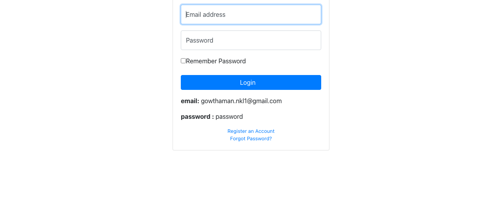
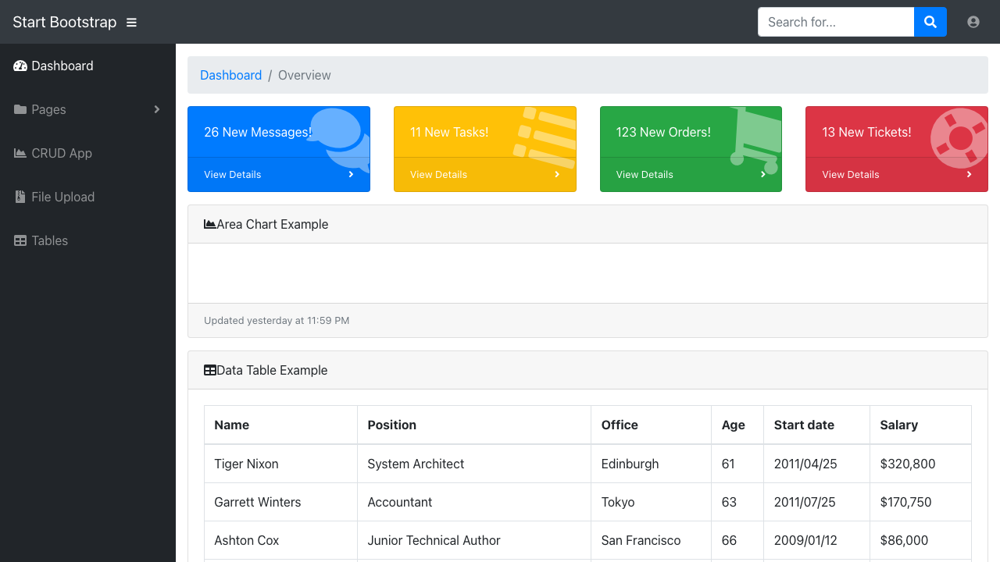
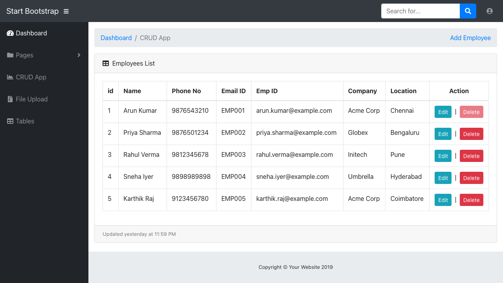
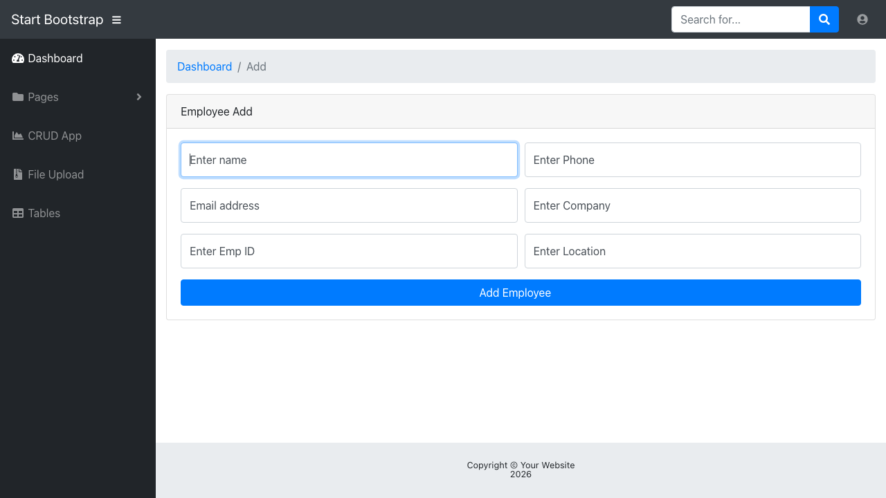
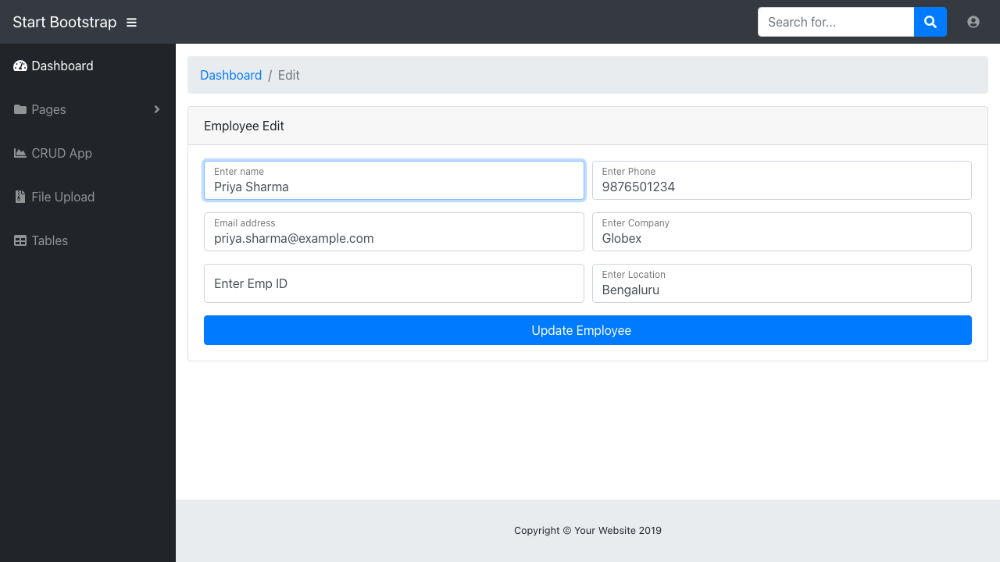
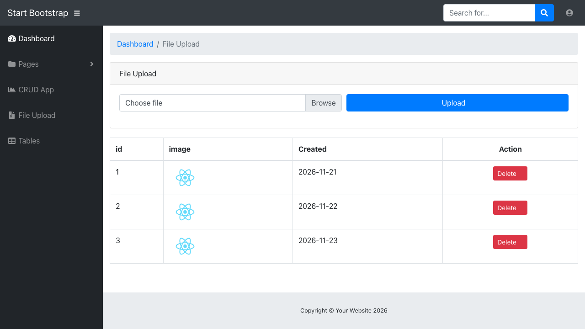

# <a href="https://github.com/gowthamand/react-login-register-crud">React CRUD, Login, Register, Dashboard</a>

[](#)
[](#)
[](#)
[](#)
[](https://reactjs-login-register-crud.vercel.app/)

<a href="https://reactjs-login-register-crud.vercel.app/"> <b>Live Demo</b></a>

**Demo login:** `gowthaman.nkl1@gmail.com` / `password`

## Key Features

- Register / Login with JWT token auth
- Protected routes: guests are sent to login, logged-in users skip login/register
- Automatic logout when the token expires (401 response)
- Employee CRUD (create, list, edit, delete)
- File upload page
- Admin dashboard UI (SB Admin, Bootstrap 4)

## Tech Stack

| Layer | Technology |
|---|---|
| UI | React 18, React Router 5 |
| Styling | Bootstrap 4, Font Awesome |
| HTTP | Axios |
| Backend API | [Laravel JWT Auth CRUD API](https://github.com/gowthamand/laravel-api-jwt-auth-crud-app) on Vercel |
| Hosting | Vercel |

## Configuration

The backend URL is set in [`src/config.js`](src/config.js) and can be overridden with an environment variable:

| Variable | Default |
|---|---|
| `REACT_APP_API_URL` | `https://laravel-api-jwt-auth-crud-app.vercel.app/` |

## Run Locally

```bash
git clone https://github.com/gowthamand/react-login-register-crud
cd react-login-register-crud
npm install
npm start
```

Open http://localhost:3000. The page reloads when you edit files.

To use a different API:

```bash
REACT_APP_API_URL=http://localhost:8000/api/ npm start
```

Production build:

```bash
npm run build
```

## Routes

| Path | Access | Page |
|---|---|---|
| `/` | Guest | Login |
| `/register` | Guest | Register |
| `/dashboard` | Logged in | Dashboard |
| `/index` | Logged in | Employee list |
| `/add` | Logged in | Add employee |
| `/edit?id=:id` | Logged in | Edit employee |
| `/fileupload` | Logged in | File upload |

## Project Structure

```
src/App.js          Routes and route guards
src/auth.js         Session helpers + 401 logout interceptor
src/config.js       API_URL
src/pages/          Login, Register, Dashboard, CRUD and upload pages
src/elements/       Header, Sidebar, Footer
src/assets/         SB Admin CSS/JS/vendor files
```

## Screenshots

**Login**



**Register**


**Dashboard**



**Employee List**



**Add Employee**



**Edit Employee**



**File Upload**



## Support

If this project helped you, you can [buy me a coffee ($1)](https://paypal.me/gowthamdurai?locale.x=en_GB).

## ⭐ Don't forget to give a star and fork!
